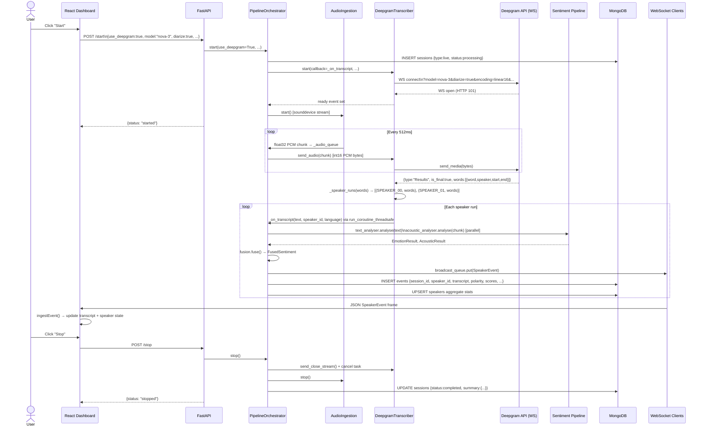
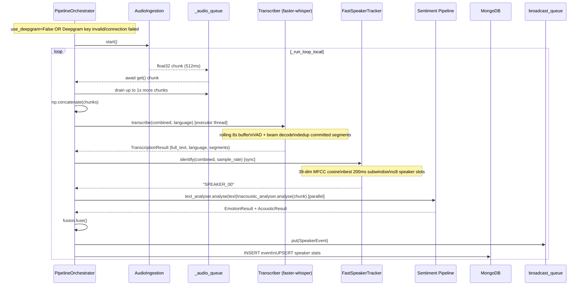
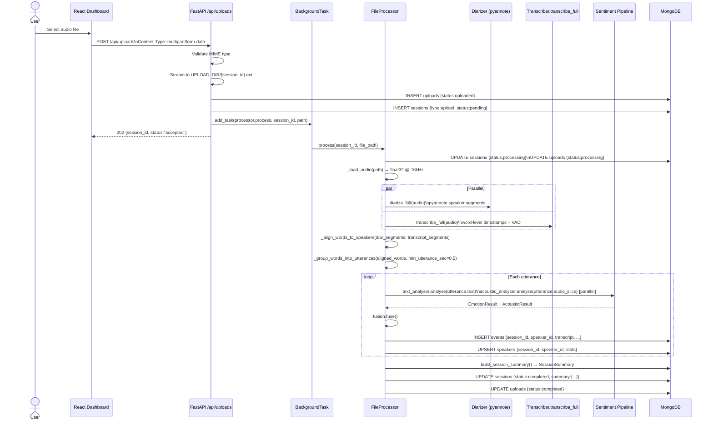
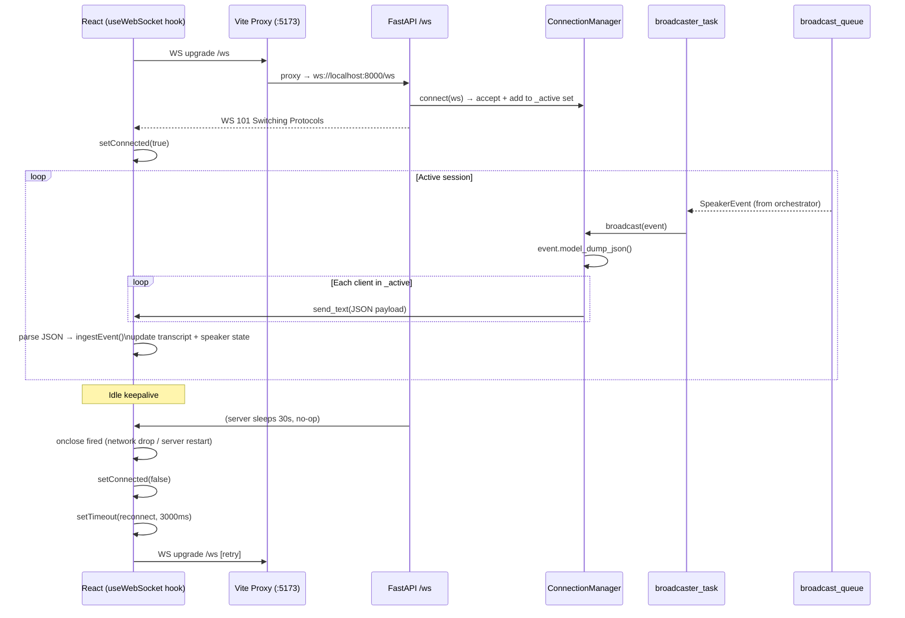
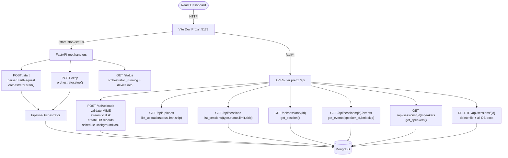
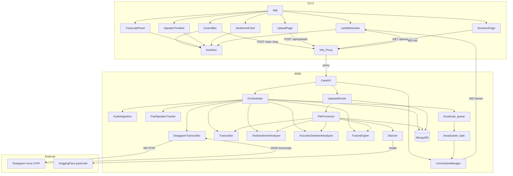
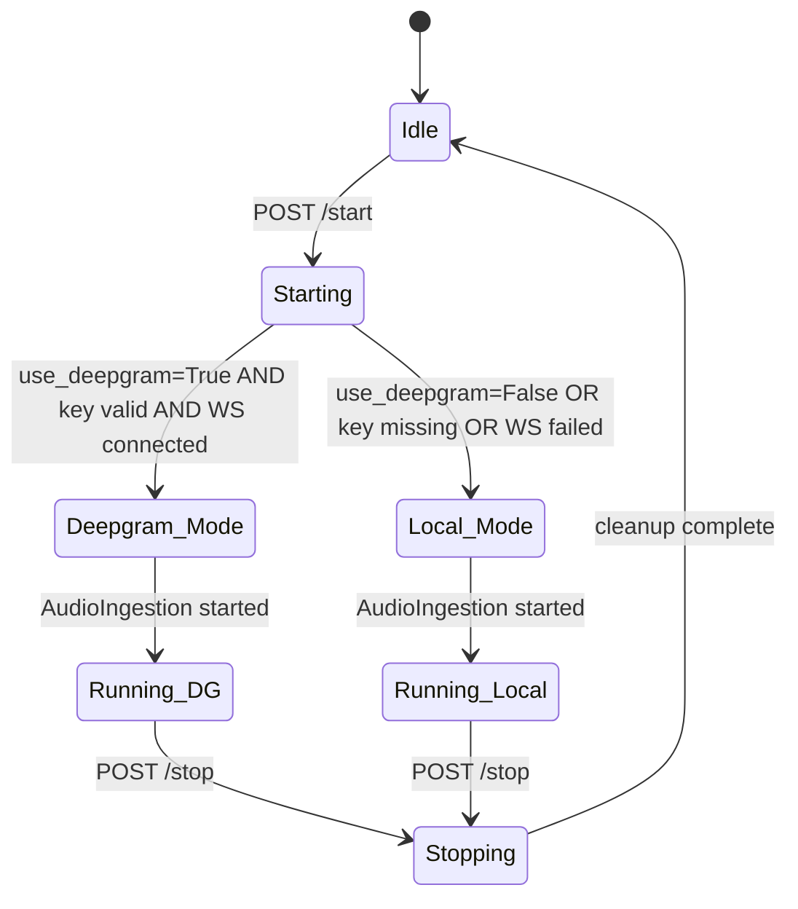
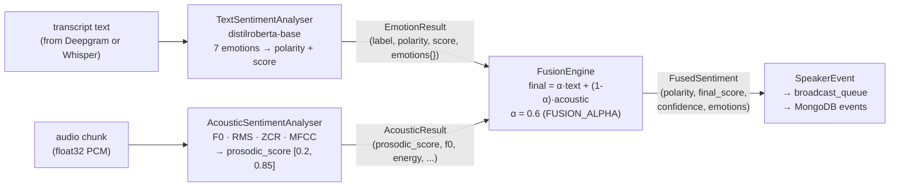
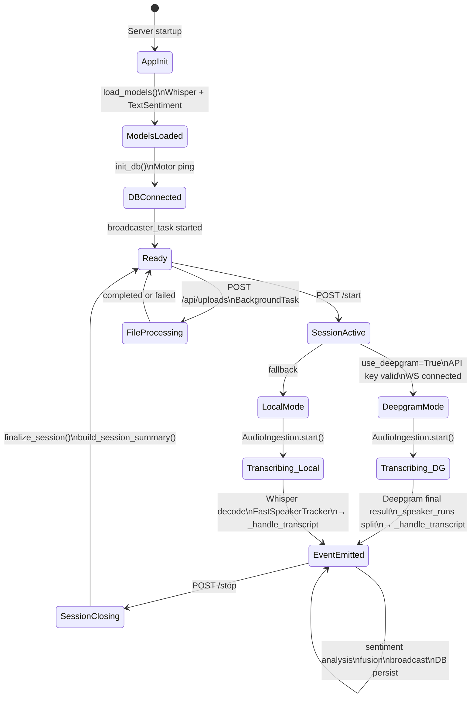

# LiveSense — Architecture & Technical Reference

> Real-time speaker diarization · multimodal sentiment analysis · live + file upload processing

---

## Table of Contents

1. [System Overview](#1-system-overview)
2. [Repository Layout](#2-repository-layout)
3. [Environment Configuration](#3-environment-configuration)
4. [End-to-End Request Flows](#4-end-to-end-request-flows)
   - 4.1 [Live Session — Deepgram Path](#41-live-session--deepgram-path)
   - 4.2 [Live Session — Local Whisper Path](#42-live-session--local-whisper-path)
   - 4.3 [File Upload Path](#43-file-upload-path)
   - 4.4 [WebSocket Connection Lifecycle](#44-websocket-connection-lifecycle)
   - 4.5 [REST API Request Flow](#45-rest-api-request-flow)
5. [Component Interaction Diagram](#5-component-interaction-diagram)
6. [Backend Module Reference](#6-backend-module-reference)
   - 6.1 [API Layer](#61-api-layer)
   - 6.2 [Pipeline Orchestrator](#62-pipeline-orchestrator)
   - 6.3 [Core Processing Modules](#63-core-processing-modules)
7. [Database Design](#7-database-design)
   - 7.1 [Collections Overview](#71-collections-overview)
   - 7.2 [sessions](#72-sessions-collection)
   - 7.3 [events](#73-events-collection)
   - 7.4 [speakers](#74-speakers-collection)
   - 7.5 [uploads](#75-uploads-collection)
   - 7.6 [Indexes](#76-indexes)
8. [REST API Contract](#8-rest-api-contract)
9. [WebSocket Protocol](#9-websocket-protocol)
10. [Frontend Architecture](#10-frontend-architecture)
    - 10.1 [Component Tree](#101-component-tree)
    - 10.2 [Zustand Store Schema](#102-zustand-store-schema)
    - 10.3 [Vite Proxy Map](#103-vite-proxy-map)
11. [Sentiment Pipeline Detail](#11-sentiment-pipeline-detail)
12. [Data Flow State Machine](#12-data-flow-state-machine)

---

## 1. System Overview

LiveSense is a full-stack application that captures microphone audio (or processes uploaded files), transcribes speech with speaker diarization, and performs real-time multimodal sentiment analysis. Results are streamed to a React dashboard over WebSocket.

```
┌─────────────────────────────────────────────────────────┐
│                     React Dashboard                      │
│  ControlBar · TranscriptPanel · SpeakerTimeline          │
│  SentimentChart · UploadPage · SessionsPage              │
└──────────┬─────────────────────────┬────────────────────┘
           │  REST /api/*            │  WebSocket /ws
           ▼                         ▼
┌─────────────────────────────────────────────────────────┐
│                   FastAPI Backend :8000                  │
│  POST /start  POST /stop  GET /status                    │
│  POST /api/uploads  GET /api/sessions/**                 │
├─────────────────────────────────────────────────────────┤
│              Pipeline Orchestrator                       │
│  ┌─────────────┐   ┌──────────────────────────────────┐ │
│  │AudioIngestion│  │     Deepgram WebSocket            │ │
│  │(sounddevice) │  │  AsyncDeepgramClient · nova-3     │ │
│  └──────┬───────┘  └──────────────┬───────────────────┘ │
│         │ float32 PCM              │ final transcript    │
│         └──────────┬───────────────┘                    │
│                    ▼                                     │
│      ┌─────────────────────────────┐                    │
│      │  TextSentimentAnalyser      │                    │
│      │  AcousticSentimentAnalyser  │  (parallel)        │
│      │  FusionEngine               │                    │
│      └────────────┬────────────────┘                    │
│                   ▼                                      │
│         SpeakerEvent → broadcast_queue                   │
├─────────────────────────────────────────────────────────┤
│              MongoDB (Motor async driver)                │
│  sessions · events · speakers · uploads                  │
└─────────────────────────────────────────────────────────┘
```

---

## 2. Repository Layout

```
livesense/
├── backend/
│   ├── .env                    # secrets + runtime config
│   ├── requirements.txt
│   ├── pytest.ini
│   ├── api/
│   │   ├── main.py             # FastAPI app factory, endpoints, lifespan
│   │   ├── schemas.py          # Pydantic request/response models
│   │   ├── websocket.py        # ConnectionManager, broadcaster task
│   │   └── uploads.py          # file upload + session REST endpoints
│   ├── config/
│   │   └── settings.py         # pydantic-settings, .env binding, lru_cache
│   ├── core/
│   │   ├── audio_ingestion.py  # sounddevice stream → async queue
│   │   ├── deepgram_transcriber.py  # AsyncDeepgramClient wrapper
│   │   ├── transcription.py    # faster-whisper, rolling buffer, dedup
│   │   ├── speaker_tracker.py  # MFCC cosine live speaker ID
│   │   ├── diarization.py      # pyannote full-file diarization
│   │   ├── file_processor.py   # upload processing pipeline
│   │   ├── text_sentiment.py   # distilroberta emotion classifier
│   │   ├── acoustic_sentiment.py  # prosody / F0 / energy
│   │   ├── fusion.py           # weighted score fusion
│   │   ├── translation.py      # optional translation
│   │   └── torchaudio_compat.py
│   ├── db/
│   │   ├── connection.py       # Motor client, index creation
│   │   ├── models.py           # MongoDB document dataclasses + enums
│   │   └── repositories.py     # CRUD + upsert functions
│   └── pipeline/
│       └── orchestrator.py     # asyncio coordinator
└── frontend/
    ├── vite.config.ts           # proxy: /ws /api /start /stop /status
    ├── tailwind.config.js
    ├── src/
    │   ├── App.tsx              # tab router, theme applicator
    │   ├── index.css            # CSS variable theme system
    │   ├── types/index.ts       # TypeScript interfaces
    │   ├── store/liveStore.ts   # Zustand global store
    │   ├── lib/api.ts           # typed fetch helpers
    │   ├── hooks/
    │   │   ├── useWebSocket.ts  # auto-reconnect WS hook
    │   │   └── useAudioLevel.ts
    │   └── components/
    │       ├── ControlBar.tsx
    │       ├── TranscriptPanel.tsx
    │       ├── SpeakerTimeline.tsx
    │       ├── SentimentChart.tsx
    │       ├── SettingsPanel.tsx
    │       ├── UploadPage.tsx
    │       └── SessionsPage.tsx
```

---

## 3. Environment Configuration

File: `backend/.env`

| Variable | Type | Default | Description |
|---|---|---|---|
| `HF_TOKEN` | string | — | HuggingFace token for pyannote diarization model |
| `DEEPGRAM_API_KEY` | string | — | Deepgram streaming API key |
| `CHUNK_MS` | int | `512` | Audio chunk size in milliseconds (128–2000) |
| `SAMPLE_RATE` | int | `16000` | Microphone sample rate in Hz |
| `AUDIO_CHANNELS` | int | `1` | Microphone channel count |
| `WHISPER_MODEL` | string | `small` | faster-whisper model: tiny / base / small / medium / large |
| `DEVICE` | string | `auto` | Compute device: auto / cpu / mps / cuda |
| `FUSION_ALPHA` | float | `0.6` | Weight of text sentiment in fusion (0.0–1.0) |
| `TRANSLATE_ENABLED` | bool | `false` | Enable post-transcription translation |
| `SOURCE_LANG` | string | `auto` | Default source language for local Whisper |
| `TARGET_LANG` | string | `en` | Translation target language |
| `HOST` | string | `0.0.0.0` | Uvicorn bind address |
| `PORT` | int | `8000` | Uvicorn port |
| `FRONTEND_ORIGIN` | string | `http://localhost:5173` | CORS allowed origin |
| `MONGODB_URL` | string | `mongodb://localhost:27017` | Motor connection URI |
| `MONGODB_DB` | string | `livesense` | Database name |
| `UPLOAD_DIR` | string | `/tmp/livesense_uploads` | File storage directory |
| `MAX_UPLOAD_MB` | int | `500` | Upload size ceiling in MB |

---

## 4. End-to-End Request Flows

### 4.1 Live Session — Deepgram Path



---

### 4.2 Live Session — Local Whisper Path



---

### 4.3 File Upload Path



---

### 4.4 WebSocket Connection Lifecycle



---

### 4.5 REST API Request Flow



---

## 5. Component Interaction Diagram



---

## 6. Backend Module Reference

### 6.1 API Layer

#### `api/main.py` — Endpoints

| Method | Path | Auth | Request Body | Response | Description |
|---|---|---|---|---|---|
| `GET` | `/status` | None | — | `PipelineStatus` | Current pipeline state + device |
| `POST` | `/start` | None | `StartRequest` | `{status: string}` | Start live capture pipeline |
| `POST` | `/stop` | None | — | `{status: string}` | Stop live pipeline, finalize session |
| `WS` | `/ws` | None | — | `SpeakerEvent` stream | Real-time event stream |
| `WS` | `/ws/speaker/{speaker_id}` | None | binary float32 PCM | — | Browser-mic audio input |
| `POST` | `/api/uploads` | None | `multipart/form-data` | `{session_id, status, message}` | Upload audio file (202) |
| `GET` | `/api/uploads` | None | `?status&limit&skip` | `List[dict]` | List upload records |
| `GET` | `/api/uploads/{session_id}` | None | — | `dict` | Single upload record |
| `GET` | `/api/sessions` | None | `?type&status&limit&skip` | `List[dict]` | List sessions |
| `GET` | `/api/sessions/{session_id}` | None | — | `dict` | Session detail + summary |
| `GET` | `/api/sessions/{session_id}/events` | None | `?speaker_id&limit&skip` | `{total, events}` | Paginated events |
| `GET` | `/api/sessions/{session_id}/speakers` | None | — | `List[dict]` | Speaker aggregate stats |
| `DELETE` | `/api/sessions/{session_id}` | None | — | `204` | Delete session + all data |

#### `api/schemas.py` — Pydantic Models

**`StartRequest`**

| Field | Type | Default | Validation |
|---|---|---|---|
| `source_lang` | `str` | `"en"` | ISO-639-1 code or `"auto"` |
| `deepgram_model` | `str` | `"nova-3"` | nova-3 / nova-2 / nova / enhanced / base |
| `diarize` | `bool` | `True` | — |
| `endpointing` | `int` | `300` | `ge=0, le=2000` (ms) |
| `punctuate` | `bool` | `True` | — |
| `use_deepgram` | `bool` | `True` | False = local Whisper path |

**`SpeakerEvent`** (WebSocket payload)

| Field | Type | Nullable | Description |
|---|---|---|---|
| `event_type` | `str` | No | Always `"speaker_event"` |
| `timestamp` | `str` | No | UTC ISO-8601 |
| `speaker_id` | `str` | No | e.g. `SPEAKER_00` |
| `transcript` | `str` | No | Transcribed text |
| `language` | `str` | No | Detected language code |
| `translation` | `str` | Yes | Optional translated text |
| `polarity` | `str` | No | `positive` / `negative` / `neutral` |
| `final_score` | `float` | No | Fused sentiment score [0, 1] |
| `text_score` | `float` | Yes | Text-only sentiment score |
| `acoustic_score` | `float` | Yes | Prosody-based score |
| `dominant_emotion` | `str` | Yes | e.g. `joy`, `anger`, `neutral` |
| `emotions` | `Dict[str,float]` | No | Full emotion distribution |
| `confidence` | `float` | No | Fusion confidence [0, 1] |

---

### 6.2 Pipeline Orchestrator



**Mode selection logic:**

```
use_deepgram=True AND DEEPGRAM_API_KEY != ""
    → DeepgramTranscriber.start()
        → success → DEEPGRAM MODE
        → exception → fallback → LOCAL MODE
use_deepgram=False OR key empty
    → LOCAL MODE (faster-whisper + FastSpeakerTracker)
```

---

### 6.3 Core Processing Modules

#### Audio Ingestion (`core/audio_ingestion.py`)

| Parameter | Value |
|---|---|
| Library | `sounddevice` |
| Sample rate | `settings.sample_rate` (default 16 000 Hz) |
| Channels | `settings.audio_channels` (default 1 / mono) |
| dtype | `float32` |
| Block size | `sample_rate × 0.032` = 512 samples @ 16 kHz |
| Emit chunk size | `sample_rate × chunk_ms / 1000` (default 512 ms = 8 192 samples) |
| Internal buffer | `collections.deque` of raw blocks |

#### Deepgram Transcriber (`core/deepgram_transcriber.py`)

| Parameter | Value |
|---|---|
| SDK | `deepgram-sdk >= 7.x` (`AsyncDeepgramClient`) |
| Endpoint | `listen.v1.connect()` (async context manager) |
| Encoding | `linear16` (int16 PCM) |
| Sample rate | 16 000 Hz |
| Diarization | per-word `speaker` field (int) |
| Result filter | `is_final=True` only |
| Speaker split | `_speaker_runs()` — consecutive same-speaker word groups |
| Callback bridge | `asyncio.run_coroutine_threadsafe` (SDK → asyncio event loop) |
| Connect timeout | 10 seconds |

#### Transcriber — Local ASR (`core/transcription.py`)

| Parameter | Value |
|---|---|
| Library | `faster-whisper` |
| Model | `settings.whisper_model` (default `small`) |
| Buffer | Rolling 8 s, minimum 1.2 s before first inference |
| Beam size | 3 |
| VAD filter | Disabled in live mode; enabled in `transcribe_full` |
| Dedup | Timestamp cursor + text ring-buffer (last 20 emissions) |
| Stability margin | 100 ms tail held back |

#### Speaker Tracker — Live (`core/speaker_tracker.py`)

| Parameter | Value |
|---|---|
| Features | 39-dim MFCC + Δ + ΔΔ, L2-normalized |
| Similarity | Cosine distance |
| New-speaker threshold | 0.62 |
| Max speakers | 8 |
| Centroid freeze after | 8 updates |
| Subwindow | Best 200 ms by RMS |
| Silence skip | RMS < 0.005 |

#### Text Sentiment (`core/text_sentiment.py`)

| Parameter | Value |
|---|---|
| Model | `j-hartmann/emotion-english-distilroberta-base` |
| Framework | HuggingFace `transformers` pipeline |
| Output labels | `anger`, `disgust`, `fear`, `joy`, `neutral`, `sadness`, `surprise` |
| Polarity map | positive → joy, surprise; negative → anger, disgust, fear, sadness; neutral → neutral |
| Score formula | `(pos×1 + neu×0.5 + neg×0) / total` |
| Max tokens | 512 (truncation enabled) |

#### Acoustic Sentiment (`core/acoustic_sentiment.py`)

| Feature | Extraction method |
|---|---|
| F0 (pitch) | `librosa.yin`, fmin 75 Hz, fmax 400 Hz |
| Energy (RMS) | Mean of RMS frames |
| Speech rate proxy | `zero_crossing_rate` mean |
| MFCCs | 13 coefficients, mean per frame |
| Prosodic score | `0.45×F0_norm + 0.35×energy_norm + 0.20×rate_norm`, mapped to [0.2, 0.85] |

#### Fusion Engine (`core/fusion.py`)

| Scenario | Formula | Confidence |
|---|---|---|
| Both text + acoustic | `alpha × text_score + (1−alpha) × acoustic_score` | `0.7 + 0.3×min(text_score, 1)` |
| Text only | `text_score` | `0.6 × text_score` |
| Acoustic only | `acoustic_score` | `0.4` |
| Neither | `0.5` | `0.0` |

Polarity thresholds:

| Score range | Polarity |
|---|---|
| ≥ 0.65 | `positive` |
| ≤ 0.40 | `negative` |
| 0.40 – 0.65 | `neutral` |

Default `FUSION_ALPHA = 0.6` (60% text, 40% acoustic).

---

## 7. Database Design

### 7.1 Collections Overview

| Collection | Purpose | Write pattern | Read pattern |
|---|---|---|---|
| `sessions` | One doc per live/upload session | Insert on start; update on stop/complete | List + detail queries |
| `events` | One doc per transcript utterance | Append-only during session | Paginated by session + speaker |
| `speakers` | Aggregate stats per speaker per session | Incremental upsert during session | Per-session speaker list |
| `uploads` | Metadata for uploaded files | Insert on receive; update on processing | List + status polling |

---

### 7.2 `sessions` Collection

| Field | BSON Type | Required | Description |
|---|---|---|---|
| `_id` | ObjectId | Auto | MongoDB document ID |
| `session_id` | String | ✓ | UUID v4 — primary business key |
| `type` | String | ✓ | `live` or `upload` |
| `status` | String | ✓ | `pending` / `processing` / `completed` / `failed` |
| `created_at` | Date | ✓ | UTC creation timestamp |
| `updated_at` | Date | ✓ | UTC last-update timestamp |
| `completed_at` | Date | — | UTC completion timestamp |
| `file` | Object | — | `FileMetadata` sub-document (upload sessions only) |
| `file.original_name` | String | — | Original uploaded filename |
| `file.stored_name` | String | — | Stored filename on disk |
| `file.size_bytes` | Int64 | — | File size |
| `file.duration_seconds` | Double | — | Audio duration |
| `file.sample_rate` | Int32 | — | Detected sample rate |
| `file.channels` | Int32 | — | Channel count |
| `file.format` | String | — | e.g. `mp3`, `wav` |
| `file.content_type` | String | — | MIME type |
| `summary` | Object | — | `SessionSummary` sub-document (post-completion) |
| `summary.event_count` | Int32 | — | Total utterances |
| `summary.speaker_count` | Int32 | — | Unique speakers detected |
| `summary.total_duration_seconds` | Double | — | Session duration |
| `summary.dominant_emotion` | String | — | Most frequent emotion |
| `summary.avg_sentiment_score` | Double | — | Session-level average |
| `summary.polarity_distribution` | Object | — | `{positive, negative, neutral}` counts |
| `summary.languages` | Array[String] | — | Detected language codes |
| `error` | String | — | Error message if `status=failed` |
| `tags` | Array[String] | — | User-defined tags |

---

### 7.3 `events` Collection

| Field | BSON Type | Required | Description |
|---|---|---|---|
| `_id` | ObjectId | Auto | MongoDB document ID |
| `session_id` | String | ✓ | Foreign key → `sessions.session_id` |
| `event_index` | Int32 | ✓ | 0-based sequential index within session |
| `timestamp_utc` | Date | ✓ | UTC time of event creation |
| `offset_seconds` | Double | ✓ | Seconds from session start (0.0 for live) |
| `speaker_id` | String | ✓ | e.g. `SPEAKER_00` |
| `transcript` | String | ✓ | Utterance text |
| `language` | String | ✓ | ISO-639-1 language code |
| `translation` | String | — | Translated text (if enabled) |
| `polarity` | String | ✓ | `positive` / `negative` / `neutral` |
| `final_score` | Double | ✓ | Fused sentiment score [0, 1] |
| `text_score` | Double | — | Text model score |
| `acoustic_score` | Double | — | Acoustic model score |
| `dominant_emotion` | String | — | Top emotion label |
| `emotions` | Object | ✓ | `{anger, disgust, fear, joy, neutral, sadness, surprise}` → float |
| `confidence` | Double | ✓ | Fusion confidence [0, 1] |

---

### 7.4 `speakers` Collection

| Field | BSON Type | Required | Description |
|---|---|---|---|
| `_id` | ObjectId | Auto | MongoDB document ID |
| `session_id` | String | ✓ | Foreign key → `sessions.session_id` |
| `speaker_id` | String | ✓ | e.g. `SPEAKER_00` |
| `total_utterances` | Int32 | ✓ | Count of utterances |
| `total_words` | Int32 | ✓ | Total word count |
| `total_speaking_seconds` | Double | ✓ | Cumulative speaking time |
| `avg_sentiment_score` | Double | ✓ | Running average fused score |
| `sentiment_score_sum` | Double | ✓ | Raw sum for online average computation |
| `dominant_emotion` | String | — | Most frequent emotion label |
| `emotion_counts` | Object | ✓ | `{emotion: count}` map |
| `polarity_counts` | Object | ✓ | `{positive, negative, neutral}` counts |
| `sentiment_timeline` | Array[Object] | ✓ | Capped at 500 points |
| `sentiment_timeline[].offset_seconds` | Double | — | Time from session start |
| `sentiment_timeline[].score` | Double | — | Fused score at this point |
| `sentiment_timeline[].speaker_id` | String | — | Redundant denormalized ID |
| `languages` | Array[String] | ✓ | Distinct language codes detected |
| `updated_at` | Date | ✓ | UTC last-update timestamp |

---

### 7.5 `uploads` Collection

| Field | BSON Type | Required | Description |
|---|---|---|---|
| `_id` | ObjectId | Auto | MongoDB document ID |
| `session_id` | String | ✓ | Foreign key → `sessions.session_id` |
| `original_filename` | String | ✓ | User-provided filename |
| `content_type` | String | ✓ | MIME type (audio/wav, audio/mp3, etc.) |
| `size_bytes` | Int64 | ✓ | File size in bytes |
| `storage_path` | String | ✓ | Absolute path on server disk |
| `status` | String | ✓ | `uploaded` / `processing` / `completed` / `failed` |
| `uploaded_at` | Date | ✓ | UTC receive timestamp |
| `processing_started_at` | Date | — | UTC when BackgroundTask began |
| `processing_completed_at` | Date | — | UTC when processing finished |
| `error` | String | — | Error message if `status=failed` |

---

### 7.6 Indexes

| Collection | Index Fields | Type | Notes |
|---|---|---|---|
| `sessions` | `session_id` | Unique | Primary lookup key |
| `sessions` | `(type, status)` | Compound | List filtering |
| `sessions` | `created_at DESC` | Single | Chronological listing |
| `events` | `(session_id, event_index)` | Unique | Dedup on insert |
| `events` | `(session_id, speaker_id)` | Compound | Speaker-filtered event fetch |
| `events` | `timestamp_utc DESC` | Single | Recent-first ordering |
| `speakers` | `(session_id, speaker_id)` | Unique | Upsert target |
| `uploads` | `session_id` | Unique | Primary lookup |
| `uploads` | `status` | Single | Status filtering |
| `uploads` | `uploaded_at DESC` | Single | Recent-first listing |

---

## 8. REST API Contract

### `POST /start`

**Request**
```json
{
  "source_lang": "en",
  "deepgram_model": "nova-3",
  "diarize": true,
  "endpointing": 300,
  "punctuate": true,
  "use_deepgram": true
}
```

**Response 200**
```json
{ "status": "started" }
```

**Response 200 (already running)**
```json
{ "status": "already running" }
```

---

### `POST /stop`

**Response 200**
```json
{ "status": "stopped" }
```

---

### `GET /status`

**Response 200**
```json
{
  "running": true,
  "device": "mps",
  "whisper_model": "small",
  "source_lang": "en"
}
```

---

### `POST /api/uploads`

**Request** — `multipart/form-data`, field `file`

**Response 202**
```json
{
  "session_id": "550e8400-e29b-41d4-a716-446655440000",
  "status": "accepted",
  "message": "File is being processed"
}
```

**Error 400** — unsupported MIME type  
**Error 413** — file exceeds `MAX_UPLOAD_MB`

---

### `GET /api/sessions/{session_id}/events`

**Query params:** `speaker_id`, `limit` (default 200), `skip` (default 0)

**Response 200**
```json
{
  "total": 42,
  "events": [
    {
      "session_id": "550e8400...",
      "event_index": 0,
      "timestamp_utc": "2026-06-21T20:00:00Z",
      "speaker_id": "SPEAKER_00",
      "transcript": "Hello world.",
      "language": "en",
      "polarity": "positive",
      "final_score": 0.72,
      "text_score": 0.78,
      "acoustic_score": 0.61,
      "dominant_emotion": "joy",
      "emotions": {"joy": 0.65, "neutral": 0.20, "surprise": 0.10, "anger": 0.02, "fear": 0.01, "sadness": 0.01, "disgust": 0.01},
      "confidence": 0.83
    }
  ]
}
```

---

### `GET /api/sessions/{session_id}/speakers`

**Response 200**
```json
[
  {
    "session_id": "550e8400...",
    "speaker_id": "SPEAKER_00",
    "total_utterances": 15,
    "total_words": 180,
    "avg_sentiment_score": 0.64,
    "dominant_emotion": "joy",
    "polarity_counts": {"positive": 9, "neutral": 5, "negative": 1},
    "sentiment_timeline": [
      {"offset_seconds": 0.0, "score": 0.70, "speaker_id": "SPEAKER_00"}
    ],
    "languages": ["en"]
  }
]
```

---

## 9. WebSocket Protocol

### Connection

```
ws://localhost:8000/ws
```

The frontend proxy (`vite.config.ts`) rewrites `/ws` → `ws://localhost:8000/ws` with `ws: true, changeOrigin: true`.

### Message Format (server → client)

All messages are JSON-serialized `SpeakerEvent` objects:

```json
{
  "event_type": "speaker_event",
  "timestamp": "2026-06-21T20:22:21.123456Z",
  "speaker_id": "SPEAKER_01",
  "transcript": "Figure out what you can tolerate.",
  "language": "en",
  "translation": null,
  "polarity": "negative",
  "final_score": 0.35,
  "text_score": 0.30,
  "acoustic_score": 0.43,
  "dominant_emotion": "sadness",
  "emotions": {
    "anger": 0.05, "disgust": 0.02, "fear": 0.03,
    "joy": 0.10, "neutral": 0.20, "sadness": 0.55, "surprise": 0.05
  },
  "confidence": 0.72
}
```

### Reconnect Logic

```
connect()
  onopen  → setConnected(true)
  onclose → setConnected(false)
            if (!unmounted) setTimeout(connect, 3000ms)
  onerror → ws.close()  [triggers onclose]
  cleanup → unmounted = true; clearTimeout; ws.close()
```

The `unmounted` flag prevents React StrictMode's double-mount from creating a spurious extra connection.

---

## 10. Frontend Architecture

### 10.1 Component Tree

```
App
├── useWebSocket()           [singleton hook, auto-reconnect]
├── Header
│   └── ControlBar           [start/stop, settings gear, audio VU]
│       └── SettingsPanel    [slide-in drawer]
├── TabBar (live | upload | sessions)
├── [live tab]
│   ├── SpeakerTimeline      [per-speaker polarity badges]
│   ├── SentimentChart       [recharts time-series]
│   └── TranscriptPanel      [typewriter animation, per-entry colour]
├── [upload tab]
│   └── UploadPage           [drag-drop, progress, session link]
└── [sessions tab]
    └── SessionsPage         [session list, detail, event replay]
```

### 10.2 Zustand Store Schema

```typescript
interface LiveStore {
  // ── Connection ──────────────────────────────────────
  connected: boolean
  pipelineRunning: boolean

  // ── Theme ───────────────────────────────────────────
  theme: 'dark' | 'midnight' | 'ember' | 'forest' | 'light'
  // persisted to localStorage key "ls-theme"

  // ── Deepgram / Pipeline settings ────────────────────
  dgSettings: {
    sourceLang: string          // default "en"
    deepgramModel: string       // default "nova-3"
    diarize: boolean            // default true
    endpointing: number         // default 300 ms
    punctuate: boolean          // default true
    useDeepgram: boolean        // default true
  }

  // ── Speaker state ────────────────────────────────────
  speakers: Map<string, SpeakerState>
  // SpeakerState: { speaker_id, latest_polarity, latest_score,
  //                 dominant_emotion, sentimentHistory: SentimentPoint[] }
  _speakerOrder: string[]       // insertion-order array for colour assignment
  speakerColour(id): string     // cycles 8-colour palette

  // ── Transcript ───────────────────────────────────────
  transcript: TranscriptEntry[]
  // TranscriptEntry: { id, speaker_id, timestamp, text, translation, polarity, language }
  // max 200 entries; deduplicated by id = "${speaker_id}-${timestamp}"
}
```

### 10.3 Vite Proxy Map

| Frontend path | Proxied to | Protocol |
|---|---|---|
| `/ws` | `ws://localhost:8000/ws` | WebSocket |
| `/api/**` | `http://localhost:8000` | HTTP |
| `/start` | `http://localhost:8000` | HTTP |
| `/stop` | `http://localhost:8000` | HTTP |
| `/status` | `http://localhost:8000` | HTTP |

> **Note:** Live pipeline controls (`/start`, `/stop`, `/status`) use the root path, while data endpoints (`/api/**`) use the `/api` prefix handled by the `uploads` APIRouter.

---

## 11. Sentiment Pipeline Detail



**Emotion-to-polarity mapping:**

| Emotion | Polarity |
|---|---|
| `joy` | positive |
| `surprise` | positive |
| `neutral` | neutral |
| `anger` | negative |
| `disgust` | negative |
| `fear` | negative |
| `sadness` | negative |

---

## 12. Data Flow State Machine



---

*Generated 2026-06-22 · LiveSense v1.0*
