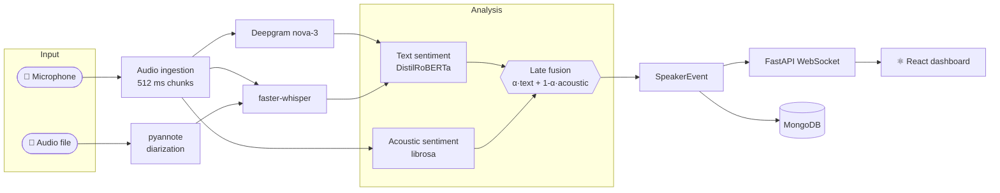

<div align="center">

# 🎙️ LiveSense

### Real-time speaker diarization & multimodal sentiment analysis.

**Hear who is speaking. See what they say. Know how they feel as it happens.**

<br />


[Quick start](#-quick-start) · [Features](#-features) · [How it works](#-how-it-works) · [Configuration](#%EF%B8%8F-configuration) · [API](#-api-reference) · [Docs](#-documentation)

<br />


</div>

---

## ✨ What is LiveSense?

Most speech tools turn audio into plain text and stop there. But *"That's fine"* means very different things said calmly versus through clenched teeth.

**LiveSense** listens to a conversation and streams, to a live dashboard, **who** is speaking, **what** they said, and **how** they feel. It fuses the *words* (linguistic) with the *voice* (pitch, energy, rhythm) into one sentiment score per speaker.

Use it for call-centre monitoring, user-interview analysis, debate and panel moderation, research on multimodal affect, or as an open, self-hostable baseline for conversation analytics.

---

## 🚀 Features

<table>
<tr>
<td width="50%" valign="top">

### 🔴 Live sessions
- Capture microphone audio in **512 ms chunks**
- Two ASR paths: **Deepgram** (`nova-3`, streaming) or **local faster-whisper**
- Live speaker tracking with MFCC cosine matching
- Results pushed to the UI over **WebSocket**

</td>
<td width="50%" valign="top">

### 📁 File upload
- Upload recorded audio (up to **500 MB**, configurable)
- Full-file **pyannote** speaker diarization
- Timestamped, per-utterance sentiment
- Background processing with status tracking

</td>
</tr>
<tr>
<td width="50%" valign="top">

### 🧠 Multimodal sentiment
- **Text:** DistilRoBERTa 7-class emotion classifier
- **Acoustic:** librosa MFCC · F0 · energy · ZCR
- **Late fusion:** `α·text + (1−α)·acoustic`
- Tunable weight via `FUSION_ALPHA`

</td>
<td width="50%" valign="top">

### 📊 Interactive dashboard
- Live scrolling **transcript** panel
- Per-speaker **sentiment timeline**
- Real-time **sentiment chart** (Recharts)
- **Sessions** history with audio playback
- Light / dark theme and settings panel

</td>
</tr>
<tr>
<td width="50%" valign="top">

### 🔐 Auth & users
- JWT login (`python-jose`) with bcrypt-hashed passwords
- Admin-only user management
- Create, deactivate, reactivate and delete accounts

</td>
<td width="50%" valign="top">

### 💾 Persistent storage
- **MongoDB** via the async Motor driver
- Collections: `sessions` · `events` · `speakers` · `uploads`
- Review and replay any past session

</td>
</tr>
<tr>
<td colspan="2" valign="top">

### 🌍 Optional translation
Translate transcripts after recognition with Helsinki-NLP MarianMT (lazy-loaded and cached). Enable it with `TRANSLATE_ENABLED=true`.

</td>
</tr>
</table>

---

## 🧩 How it works



### Sentiment score

The final score is a weighted blend of the text and acoustic channels (default α = 0.6, text-dominant):

```text
score = α · text_score + (1 − α) · acoustic_score
```

| Score | Polarity |
|:---:|:---|
| **≥ 0.65** | 🟢 Positive |
| **0.41 – 0.64** | 🟡 Neutral |
| **≤ 0.40** | 🔴 Negative |

---

## 🛠️ Tech stack

| Layer | Technologies |
|---|---|
| **Backend** | Python · FastAPI · Uvicorn · WebSockets · Pydantic · asyncio |
| **Speech & ML** | faster-whisper · Deepgram · pyannote.audio 3.3 · Transformers · PyTorch · librosa · sounddevice |
| **Frontend** | React 18 · TypeScript · Vite · Tailwind CSS · Zustand · Recharts |
| **Data** | MongoDB (Motor / PyMongo) |
| **Auth** | JWT · bcrypt |
| **Tooling** | pytest · pytest-asyncio · ruff · ESLint · Make |

### Models

| Model | Purpose | Size |
|---|---|---|
| `pyannote/speaker-diarization-3.1` | Speaker diarization | ~100 MB |
| `openai/whisper-small` (via faster-whisper) | Speech recognition | ~244 MB |
| `j-hartmann/emotion-english-distilroberta-base` | Text emotion | ~330 MB |
| `Helsinki-NLP/opus-mt-{src}-en` | Translation (optional) | ~300 MB / pair |

Models download once and are cached in `~/.cache/huggingface/`.

---

## ⚡ Quick start

### Prerequisites

| Requirement | Notes |
|---|---|
| **Python** | 3.11+ |
| **Node.js** | 20 LTS recommended (18+ works) |
| **MongoDB** | Running locally or remotely (`mongodb://localhost:27017` by default) |
| **Hugging Face token** | Free; needed for pyannote |
| **Deepgram API key** | Optional; only for the streaming Deepgram path |

<details>
<summary><strong>🔑 How to get a free Hugging Face token</strong></summary>

1. Create a free account at <https://huggingface.co>
2. Accept the model terms at <https://hf.co/pyannote/speaker-diarization-3.1>
3. Generate a token at <https://hf.co/settings/tokens>

</details>

### Install & run

```bash
# 1. Enter the project
cd livesense

# 2. Create your env file, then set HF_TOKEN (and DEEPGRAM_API_KEY if used)
cp backend/.env.example backend/.env

# 3. Install backend + frontend dependencies
make setup

# 4. Terminal 1: start the API on :8000
make run-backend

# 5. Terminal 2: start the dashboard on :5173
make run-frontend
```

Open **<http://localhost:5173>**, sign in, and press **Start**.

> [!NOTE]
> The first run downloads about 900 MB of model weights. Later runs load from cache.

### Make commands

| Command | What it does |
|---|---|
| `make setup` | Create the Python venv and install backend + frontend dependencies |
| `make run-backend` | Start FastAPI with hot-reload on `http://localhost:8000` |
| `make run-frontend` | Start the Vite dev server on `http://localhost:5173` |
| `make test` | Run the backend test suite |
| `make lint` | Run ruff (backend) and ESLint (frontend) |
| `make clean` | Remove venv, `node_modules`, build output and caches |

---

## ⚙️ Configuration

All settings live in `backend/.env`.

| Variable | Default | Description |
|---|---|---|
| `HF_TOKEN` | *(required)* | Hugging Face token for pyannote |
| `DEEPGRAM_API_KEY` | — | Enables the Deepgram streaming path |
| `WHISPER_MODEL` | `small` | `tiny` · `base` · `small` · `medium` · `large` |
| `DEVICE` | `auto` | `auto` · `cpu` · `mps` · `cuda` |
| `FUSION_ALPHA` | `0.6` | Text weight in fusion (0–1) |
| `CHUNK_MS` | `512` | Audio chunk size in ms (128–2000) |
| `SAMPLE_RATE` | `16000` | Microphone sample rate (Hz) |
| `AUDIO_CHANNELS` | `1` | Microphone channels |
| `TRANSLATE_ENABLED` | `false` | Enable MarianMT translation |
| `SOURCE_LANG` / `TARGET_LANG` | `auto` / `en` | Translation languages |
| `MONGODB_URL` / `MONGODB_DB` | `mongodb://localhost:27017` / `livesense` | Database connection |
| `UPLOAD_DIR` / `MAX_UPLOAD_MB` | `/tmp/livesense_uploads` / `500` | Upload storage and size limit |
| `HOST` / `PORT` | `0.0.0.0` / `8000` | API bind address |
| `FRONTEND_ORIGIN` | `http://localhost:5173` | Allowed CORS origin |

> [!WARNING]
> Never commit `backend/.env`. It holds your API keys and tokens.

---

## 🔌 API reference

| Method | Endpoint | Description |
|---|---|---|
| `POST` | `/auth/login` | Sign in and receive a JWT |
| `GET` | `/auth/me` | Current user |
| `POST` | `/start` · `/stop` | Start or stop the live pipeline |
| `GET` | `/status` | Pipeline status |
| `WS` | `/ws` | Live stream of speaker events |
| `WS` | `/ws/speaker/{speaker_id}` | Stream for a single speaker |
| `POST` | `/api/uploads` | Upload an audio file for processing |
| `GET` | `/api/uploads` · `/api/uploads/{id}` | List uploads or check one |
| `GET` | `/api/sessions` · `/api/sessions/{id}` | List sessions or fetch one |
| `GET` | `/api/sessions/{id}/events` | Per-utterance events |
| `GET` | `/api/sessions/{id}/speakers` | Speakers in a session |
| `GET` | `/api/sessions/{id}/audio` | Session audio |
| `DELETE` | `/api/sessions/{id}` | Delete a session |
| `GET/POST/PATCH/DELETE` | `/users/**` | Admin-only user management |

While the backend is running, FastAPI serves interactive docs at **<http://localhost:8000/docs>**.

---

## 📂 Project structure

```text
livesense/
├── backend/
│   ├── api/                  FastAPI app, auth, users, uploads, WebSocket
│   ├── core/
│   │   ├── audio_ingestion.py       sounddevice → asyncio queue
│   │   ├── deepgram_transcriber.py  Deepgram streaming client
│   │   ├── transcription.py         faster-whisper ASR
│   │   ├── speaker_tracker.py       live speaker ID (MFCC cosine)
│   │   ├── diarization.py           pyannote full-file diarization
│   │   ├── file_processor.py        upload processing pipeline
│   │   ├── text_sentiment.py        DistilRoBERTa emotion classifier
│   │   ├── acoustic_sentiment.py    prosody / F0 / energy
│   │   ├── fusion.py                weighted late fusion
│   │   └── translation.py           optional MarianMT
│   ├── db/                   Motor connection, models, repositories
│   ├── pipeline/             asyncio orchestrator
│   ├── config/               pydantic-settings
│   └── tests/                sentiment + pipeline tests
├── frontend/
│   └── src/
│       ├── components/       ControlBar · TranscriptPanel · SpeakerTimeline
│       │                     SentimentChart · UploadPage · SessionsPage
│       │                     SettingsPanel · LoginPage · RegisterUserPage
│       ├── hooks/            useWebSocket · useAudioLevel
│       ├── store/            Zustand global store
│       └── lib/ · types/     typed API helpers and interfaces
├── ARCHITECTURE.md
├── GUIDE.md
├── PROBLEM_STATEMENT.md
└── Makefile
```

---

## 🧪 Testing

```bash
make test
```

Unit tests mock the ML models; the pipeline integration test uses real asyncio with mocked inference, so no model downloads are needed.

---

## 📚 Documentation

| Document | Contents |
|---|---|
| [ARCHITECTURE.md](ARCHITECTURE.md) | Request flows, module reference, database design, REST and WebSocket contracts |
| [GUIDE.md](GUIDE.md) | Step-by-step setup and running guide |
| [PROBLEM_STATEMENT.md](PROBLEM_STATEMENT.md) | Motivation, stakeholders and use cases |

---

## 🔒 Privacy

Local Whisper, pyannote and the sentiment models run entirely on your machine. If you enable the **Deepgram** path, live audio is sent to Deepgram for transcription under their terms. Leave `DEEPGRAM_API_KEY` empty to stay fully local.

---

<div align="center">

**Built with ❤️ for people who listen closely...**

</div>
